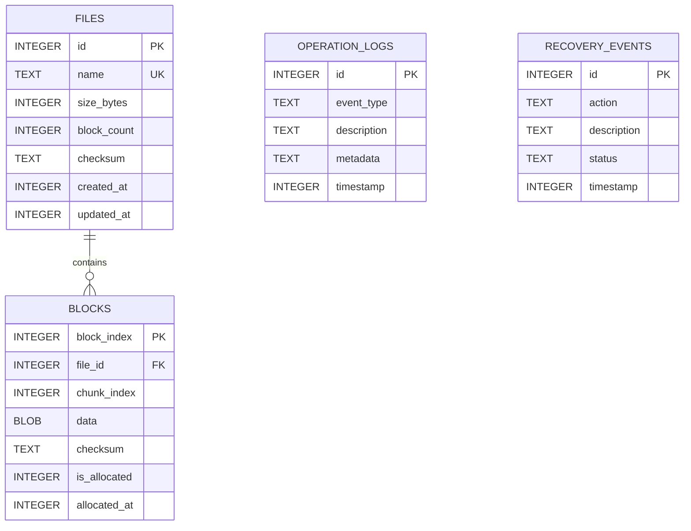

# OSVault — Database Architecture & Schema Design

## 1. Overview & Engine Specification

OSVault utilizes **SQLite 3.47.0** compiled from source via the official SQLite amalgamation (`third_party/sqlite/sqlite3.c`).

### Compilation Flags:
- `SQLITE_THREADSAFE=1`: Multi-threaded mode; safe to use SQLite across multiple threads with serialized transactions.
- `SQLITE_ENABLE_WAL=1`: Enables Write-Ahead Logging (WAL) mode for maximum concurrency and crash-durability.
- `SQLITE_ENABLE_COLUMN_METADATA=1`: Enables rich metadata inspection for introspective queries.

---

## 2. PRAGMA Configuration & Concurrency Tuning

Upon opening the database file (`data/osvault.db`), the RAII `osvault::Database` wrapper initializes the connection with the following deterministic PRAGMAs:

```sql
PRAGMA journal_mode = WAL;
PRAGMA synchronous = NORMAL;
PRAGMA foreign_keys = ON;
PRAGMA busy_timeout = 5000;
PRAGMA temp_store = MEMORY;
```

### Rationale:
1. **`journal_mode = WAL`**:
   - Readers never block writers, and writers never block readers.
   - Writes append to the `osvault.db-wal` file sequentially rather than performing random-access page overwrites in the main database file.
   - Prevents database corruption even during abrupt power loss or operating system crashes.
2. **`synchronous = NORMAL`**:
   - In WAL mode, `NORMAL` guarantees full ACID compliance while avoiding redundant disk flushes on every single transaction, dramatically improving throughput.
3. **`foreign_keys = ON`**:
   - Enforces referential integrity at the database engine level (e.g., `blocks.file_id` referencing `files.id`).
4. **`busy_timeout = 5000`**:
   - Prevents transient `SQLITE_BUSY` lock contentions by retrying queries automatically for up to 5000 milliseconds before raising an error.

---

## 3. Relational Schema Design



### 3.1 `files` (Virtual Inode Table)
Represents virtual files stored in OSVault's virtual filesystem.

| Column | Type | Constraints | Description |
|---|---|---|---|
| `id` | `INTEGER` | `PRIMARY KEY AUTOINCREMENT` | Unique inode identifier |
| `name` | `TEXT` | `NOT NULL UNIQUE` | Virtual filename / path |
| `size_bytes` | `INTEGER` | `NOT NULL DEFAULT 0` | Exact size in bytes |
| `block_count` | `INTEGER` | `NOT NULL DEFAULT 0` | Number of 4096-byte blocks allocated |
| `checksum` | `TEXT` | `NOT NULL DEFAULT ''` | SHA-256 / Adler-32 content checksum |
| `created_at` | `INTEGER` | `NOT NULL` | Unix timestamp of creation |
| `updated_at` | `INTEGER` | `NOT NULL` | Unix timestamp of last modification |

### 3.2 `blocks` (Physical Sector Allocation Bitmap & Data Store)
Represents the 1024 discrete 4096-byte logical sectors.

| Column | Type | Constraints | Description |
|---|---|---|---|
| `block_index` | `INTEGER` | `PRIMARY KEY` | Block index ($0 \le i \le 1023$) |
| `file_id` | `INTEGER` | `REFERENCES files(id) ON DELETE SET NULL` | Inode owning this block |
| `chunk_index` | `INTEGER` | `DEFAULT 0` | Ordered chunk offset within the file |
| `data` | `TEXT` | `DEFAULT ''` | Stored payload (up to 4096 bytes) |
| `checksum` | `TEXT` | `DEFAULT ''` | Checksum of payload |
| `is_allocated`| `INTEGER` | `NOT NULL DEFAULT 0` | `1` if allocated, `0` if free |
| `allocated_at`| `INTEGER` | `DEFAULT 0` | Unix timestamp of allocation |

### 3.3 `operation_logs` (Audit Log Stream)
Stores timestamped event streams for auditing and demonstration.

| Column | Type | Constraints | Description |
|---|---|---|---|
| `id` | `INTEGER` | `PRIMARY KEY AUTOINCREMENT` | Sequential event counter |
| `event_type` | `TEXT` | `NOT NULL` | e.g. `FILE_CREATE`, `BLOCK_ALLOC`, `DEADLOCK` |
| `description`| `TEXT` | `NOT NULL` | Human-readable event description |
| `metadata` | `TEXT` | `DEFAULT ''` | Additional parameters / JSON metadata |
| `timestamp` | `INTEGER` | `NOT NULL` | Epoch timestamp |

### 3.4 `recovery_events` (Crash & Integrity Audit History)
Maintains audit trail of all integrity scans and orphan block repairs.

| Column | Type | Constraints | Description |
|---|---|---|---|
| `id` | `INTEGER` | `PRIMARY KEY AUTOINCREMENT` | Event sequence ID |
| `action` | `TEXT` | `NOT NULL` | `CHECK`, `REPAIR_ORPHAN`, `CRASH_SIM`, `REBOOT` |
| `description`| `TEXT` | `NOT NULL` | Diagnostic details |
| `status` | `TEXT` | `NOT NULL` | `OK`, `REPAIRED`, `INCONSISTENCY` |
| `timestamp` | `INTEGER` | `NOT NULL` | Epoch timestamp |

---

## 4. Crash Consistency & Atomicity Model

In file system architecture, writing data requires updating both:
1. **Data Blocks:** Physical sectors containing the payload.
2. **Metadata (Inode):** File size, block pointer array, timestamps.

If a power cut or system crash occurs after data blocks are written but *before* metadata is committed, two failure modes emerge:
- **Orphan Blocks (Storage Leaks):** Blocks marked as allocated in the free bitmap, but not referenced by any file inode.
- **Corrupted Inodes:** File metadata pointing to unallocated or unwritten blocks.

### OSVault's Dual Protection Strategy:
1. **SQLite WAL Atomic Commits:**
   - Under normal operation, file creation, block reservation, and inode record creation occur within a single atomic database transaction (`BEGIN IMMEDIATE` ... `COMMIT`).
   - If a failure interrupts the transaction, SQLite's WAL replay either completely applies or cleanly discards the transaction, preserving consistency.
2. **Crash Consistency Demonstration & Integrity Checker:**
   - To simulate crash-consistency challenges, OSVault's `/api/recovery/interrupted-write` endpoint deliberately executes an uncommitted block allocation to simulate an interrupted disk write.
   - The `IntegrityChecker` executes cross-referencing queries between `files` and `blocks`, identifying orphan blocks and offering one-click automated reclamation (`/api/integrity/fix-orphans`).
